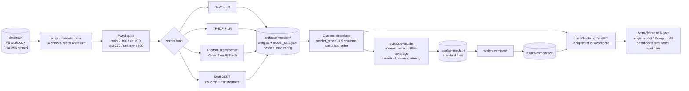

# Architecture



```text
 command ─► model.predict_proba ─► 9 probabilities ─► max ≥ threshold ? ─► yes ─► intent ─► simulated workflow
                                                                      └► no  ─► UNKNOWN_INTENT ─► clarify / Help & Support
 money-moving intent (transfer, bill, withdraw) ─► explicit confirmation (simulated; nothing is ever executed)
```

## Packages

| Path | Role |
|---|---|
| `src/sole_smart_actions/config.py` | loads `config/common.yaml` + `config/<model>.yaml` (smoke overrides), repository-relative paths |
| `src/sole_smart_actions/data/` | canonical loader + validation (`DatasetValidationError`) |
| `src/sole_smart_actions/models/` | `IntentModel` interface and one adapter per model (`bow/`, `tfidf/`, `transformer/`, `distilbert/`) |
| `src/sole_smart_actions/training.py` | train under a protocol, write the artifact directory and its model card, `load_trained` |
| `src/sole_smart_actions/evaluation/` | metrics, thresholds (calibration, sweep, secondary analyses), plots, per-model report |
| `src/sole_smart_actions/comparison.py` | cross-model table, markdown and charts |
| `src/sole_smart_actions/reproducibility.py` | environment check against `requirements.lock`, schema checks, reproduced-vs-published comparison |
| `src/sole_intent/` | the original Bag of Words package (also the historical V4/V5 pipeline); reused by the BoW adapter and the metric code |
| `scripts/` | command-line entry points (`python -m scripts.<name>`) |
| `demo/backend/` | FastAPI: model registry (lazy neural loading), threshold decision, simulated workflow |
| `demo/frontend/` | React + TypeScript + Vite + Tailwind + Recharts |
| `research/original_experiments/` | the teammates' original notebooks and results |

## Outputs

| Folder | Content | Committed |
|---|---|---|
| `artifacts/<model>/` | trained primary models; `*.safetensors` / `*.h5` through Git LFS | yes |
| `artifacts/secondary/` | train+validation refits and ablations | yes |
| `artifacts/history/` | historical BoW V4/V5 models | yes |
| `results/<model>/` | standard evaluation files | yes |
| `results/comparison/` | four-model comparison and reproducibility report | yes |
| `results/secondary/`, `results/history/` | secondary experiments; historical BoW runs | yes |
| `data/external/` | pinned pretrained downloads | no (download script) |
| `reproduction/` | local `scripts.reproduce_all` runs | no |
