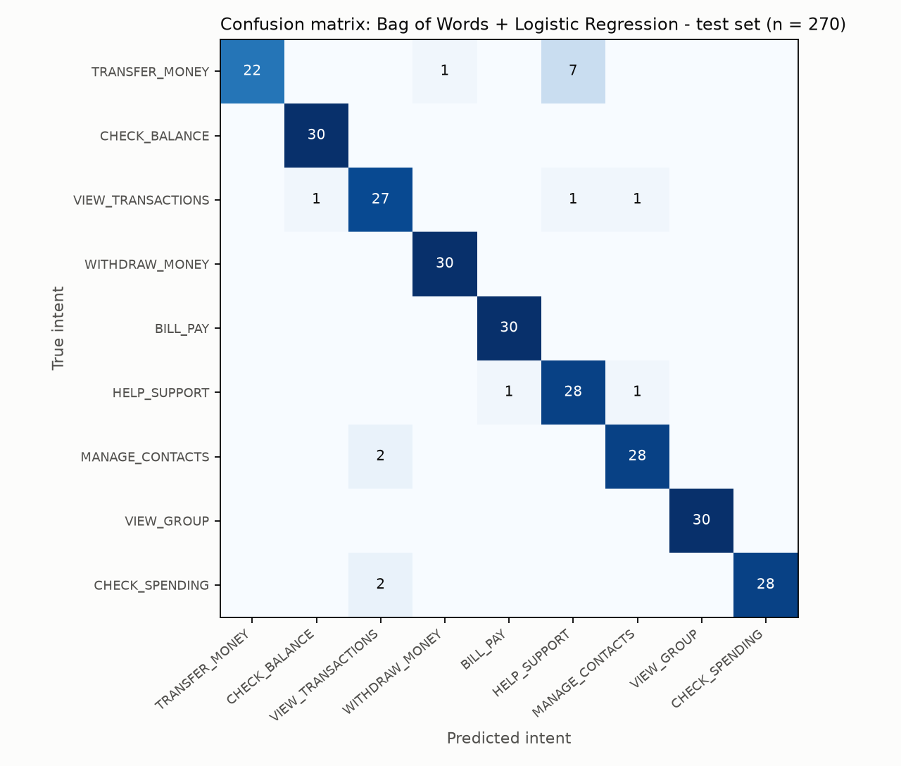
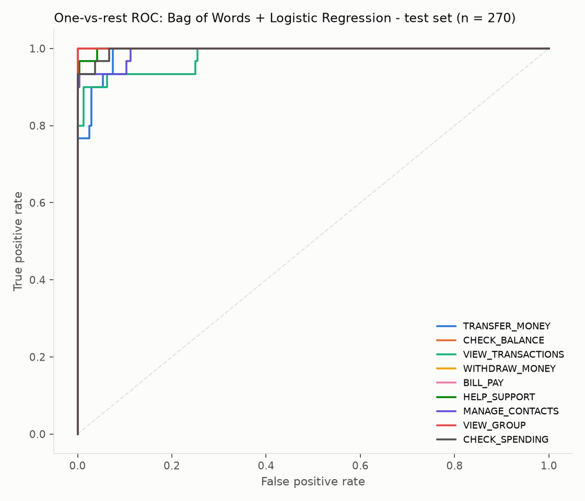
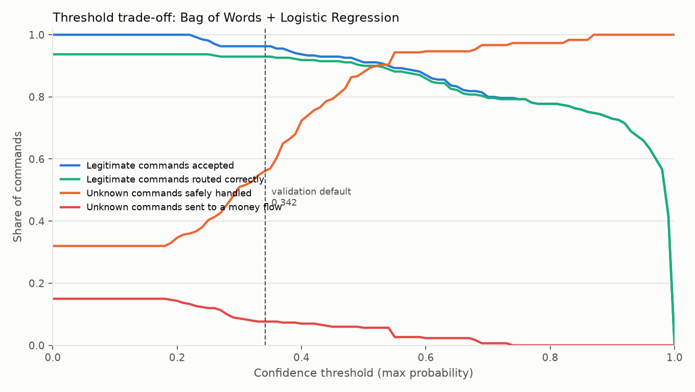

# Bag of Words + Logistic Regression - evaluation report

_Generated 2026-11-16T18:07:59+00:00 from the model's actual predictions. Dataset `v5_deduplicated` (SHA-256 `8dc9c89cbb8af41f...`). Original implementation: penin._

## Headline (raw classifier, no confidence threshold)

| Metric | Value |
|---|---|
| Raw test accuracy | **93.7%** (253 / 270) |
| Test macro precision / recall / F1 | 0.943 / 0.937 / **0.937** |
| Test weighted F1 | 0.937 |
| Test macro ROC-AUC (one-vs-rest) | 0.995 |
| Train / validation accuracy | 100.0% / 91.9% |
| Parameters | 23,265 |
| Serialized model size | 0.23 MB |
| Training time (final fit / incl. search) | 0.1 s / 1.8 s |
| Latency P50 / P95 (single command, cpu) | 0.19 / 0.21 ms |

Raw accuracy counts every one of the legitimate test commands, before any confidence threshold.

## Selected configuration (chosen on validation only)

- Hyperparameters: `{'ngram_range': [1, 2], 'C': 10.0, 'binary': True}`
- Rule: highest validation macro F1; ties -> lowest validation log loss
- Configurations searched: 12

## Per-intent results (test)

| Intent | Precision | Recall | F1 | Support |
|---|---|---|---|---|
| TRANSFER_MONEY | 1.000 | 0.733 | 0.846 | 30 |
| CHECK_BALANCE | 0.968 | 1.000 | 0.984 | 30 |
| VIEW_TRANSACTIONS | 0.871 | 0.900 | 0.885 | 30 |
| WITHDRAW_MONEY | 0.968 | 1.000 | 0.984 | 30 |
| BILL_PAY | 0.968 | 1.000 | 0.984 | 30 |
| HELP_SUPPORT | 0.778 | 0.933 | 0.848 | 30 |
| MANAGE_CONTACTS | 0.933 | 0.933 | 0.933 | 30 |
| VIEW_GROUP | 1.000 | 1.000 | 1.000 | 30 |
| CHECK_SPENDING | 1.000 | 0.933 | 0.966 | 30 |

## Confidence threshold

Default threshold **0.3415**, calibrated on validation only: largest observed validation max-probability with coverage >= target (sole_intent.rejection.threshold_for_coverage); target coverage 95%, actual validation coverage 95.2%. No test or unknown-evaluation labels were used.

| Threshold | Coverage | Accepted | Correct accepted | Accuracy among accepted | Overall correct routing | Rejected | Unknown rejected | Unknown -> HELP_SUPPORT | Unknown safe fallback | Unknown -> money flow |
|---|---|---|---|---|---|---|---|---|---|---|
| none | 100.0% | 270 | 253 | 93.7% | 93.7% | 0 | 0.0% | 96 | 32.0% | 45 |
| default (0.342) | 96.3% | 260 | 251 | 96.5% | 93.0% | 10 | 29.3% | 80 | 56.0% | 23 |
| 0.25 | 98.1% | 265 | 253 | 95.5% | 93.7% | 5 | 10.3% | 90 | 40.3% | 36 |
| 0.30 | 96.3% | 260 | 251 | 96.5% | 93.0% | 10 | 22.3% | 86 | 51.0% | 26 |
| 0.35 | 96.3% | 260 | 251 | 96.5% | 93.0% | 10 | 30.3% | 80 | 57.0% | 23 |
| 0.40 | 93.7% | 253 | 248 | 98.0% | 91.9% | 17 | 49.3% | 69 | 72.3% | 21 |
| 0.50 | 91.1% | 246 | 243 | 98.8% | 90.0% | 24 | 74.0% | 42 | 88.0% | 17 |
| 0.60 | 87.0% | 235 | 232 | 98.7% | 85.9% | 35 | 88.0% | 20 | 94.7% | 7 |

*Accuracy among accepted* uses only the accepted commands as denominator; *overall correct routing* uses all legitimate test commands and counts rejections as failures. UNKNOWN_INTENT (rejected) and HELP_SUPPORT are counted separately; both are safe fallbacks.

## Secondary analyses (not part of the primary comparison)

- Typo robustness: accuracy with one keyboard slip per command 81.5% (clean 93.7%), macro F1 0.817.
- Temperature scaling (fit on validation): T = 0.872; test ECE 0.065 -> 0.047, test log loss 0.247 -> 0.227.
- Three-tier routing (open >= 0.342, menu >= 0.256): 93.0% of legitimate commands open the right workflow, 0.4% get a top-3 menu containing the right intent, 3.3% open a wrong workflow; 70.7% of unknown commands open a workflow (7.7% a money flow).

## Figures

## Provenance

- Training command: `python -c`; evaluation command: `python evaluate.py --model all`
- Trained on: train; selected on: validation
- Artifact: `artifacts/bow` (2 files, hashes in `experiment_metadata.json`)
- Git commit at evaluation: `1cd668e6e692a9b99e4b4bd20a3bff4c7a08faf0`
