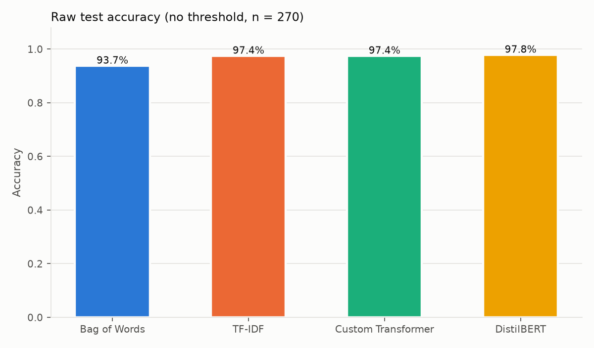
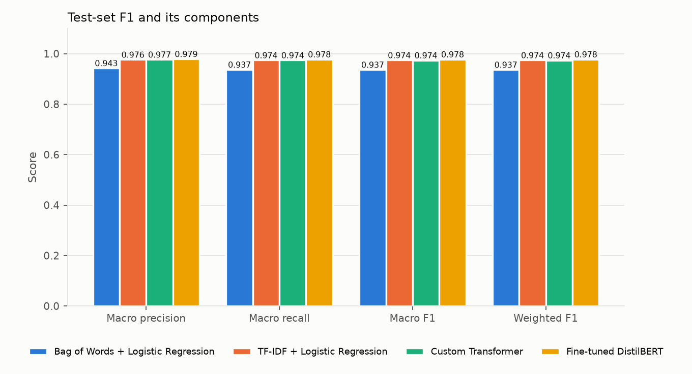
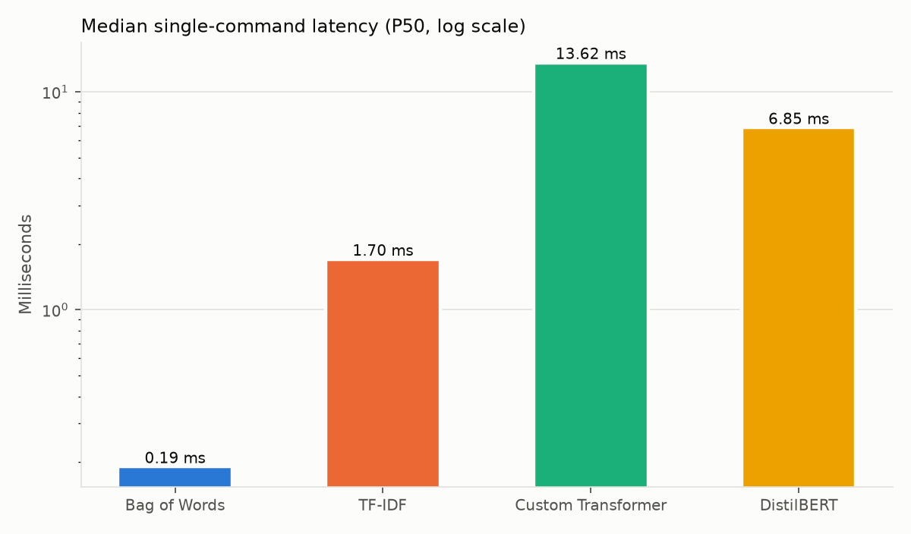
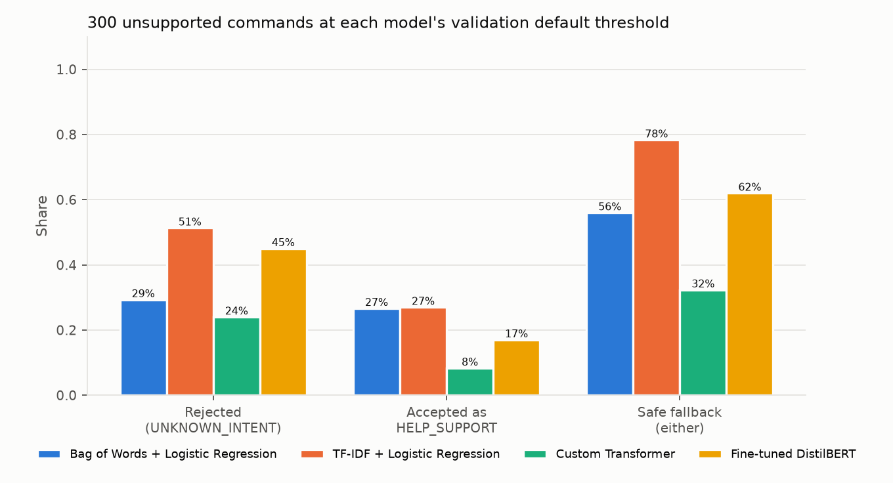

# Sole Smart Actions - four-model comparison (primary protocol)

_Generated 2026-11-16T18:08:33+00:00 from `results/<model>/` (actual predictions). All models: Dataset V5, trained on the 2,160 training commands only, selected and threshold-calibrated on the 270 validation commands, scored once on the same 270 test and 300 unknown-evaluation commands, nine intents in the same order._

## Classification (raw, no confidence threshold)

| Model | Raw test accuracy | Macro P | Macro R | Macro F1 | Weighted F1 | ROC-AUC (OvR) | Train acc | Val acc |
|---|---|---|---|---|---|---|---|---|
| Bag of Words + Logistic Regression | **93.7%** (253/270) | 0.943 | 0.937 | **0.937** | 0.937 | 0.995 | 100.0% | 91.9% |
| TF-IDF + Logistic Regression | **97.4%** (263/270) | 0.976 | 0.974 | **0.974** | 0.974 | 0.997 | 100.0% | 94.1% |
| Custom Transformer | **97.4%** (263/270) | 0.977 | 0.974 | **0.974** | 0.974 | 1.000 | 99.9% | 93.0% |
| Fine-tuned DistilBERT | **97.8%** (264/270) | 0.979 | 0.978 | **0.978** | 0.978 | 1.000 | 100.0% | 92.2% |

## Routing at each model's validation-calibrated default threshold (95% validation coverage)

| Model | Threshold | Test coverage | Accuracy among accepted | Overall correct routing | Unknown rejected | Unknown -> HELP_SUPPORT | Unknown safe fallback | Unknown -> money flow |
|---|---|---|---|---|---|---|---|---|
| Bag of Words + Logistic Regression | 0.342 | 96.3% | 96.5% | 93.0% | 29.3% | 26.7% | 56.0% | 23 / 300 |
| TF-IDF + Logistic Regression | 0.404 | 98.9% | 98.1% | 97.0% | 51.3% | 27.0% | 78.3% | 17 / 300 |
| Custom Transformer | 0.660 | 96.3% | 98.1% | 94.4% | 24.0% | 8.3% | 32.3% | 17 / 300 |
| Fine-tuned DistilBERT | 0.676 | 97.4% | 99.2% | 96.7% | 45.0% | 17.0% | 62.0% | 14 / 300 |

Thresholds differ by model because their probability distributions differ; each is calibrated the same way. *Accuracy among accepted* is selective accuracy and is never the headline accuracy.

## Cost and robustness

| Model | Parameters | Size | Latency P50 / P95 | Training (final fit) | Typo-test accuracy | Selected configuration |
|---|---|---|---|---|---|---|
| Bag of Words + Logistic Regression | 23,265 | 0.23 MB | 0.19 / 0.21 ms (cpu) | 0.1 s | 81.5% | `{'ngram_range': [1, 2], 'C': 10.0, 'binary': True}` |
| TF-IDF + Logistic Regression | 61,983 | 0.64 MB | 1.70 / 2.66 ms (cpu) | 0.4 s | 95.9% | `{'word_ngram': [1, 2], 'char': [2, 5], 'C': 10}` |
| Custom Transformer | 232,561 | 2.93 MB | 13.62 / 20.87 ms (cuda) | 36.2 s | 78.1% | `{'num_heads': 4, 'num_blocks': 2, 'dropout': 0.2, 'learning_rate': 0.001, 'epochs': 5}` |
| Fine-tuned DistilBERT | 66,960,393 | 134.65 MB | 6.85 / 9.72 ms (cuda) | 19.0 s | 85.6% | `{'strategy': 'top_2_blocks', 'unfrozen_blocks': 2, 'learning_rate': 0.0001, 'epochs': 2, 'schedule_epochs': 6}` |

Latency is single-command end-to-end inference on the evaluation machine (see `experiment_metadata.json`); neural models ran on the GPU when available, so latencies are not hardware-neutral.

## Caveats

- The dataset is synthetic. No exact or normalized duplicates cross splits, but many test commands share sentence templates with training commands, so test accuracy overstates performance on real customer text.
- 270 test commands: one command is 0.37 percentage points; differences of a few commands are within noise.
- Unknown-intent handling uses only a confidence threshold; none of the models was trained on unsupported requests.

