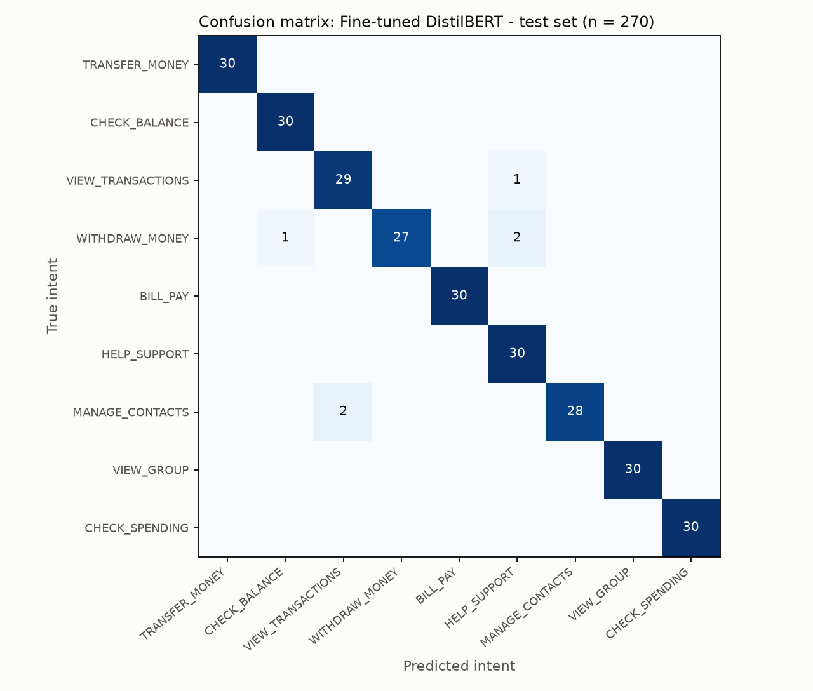
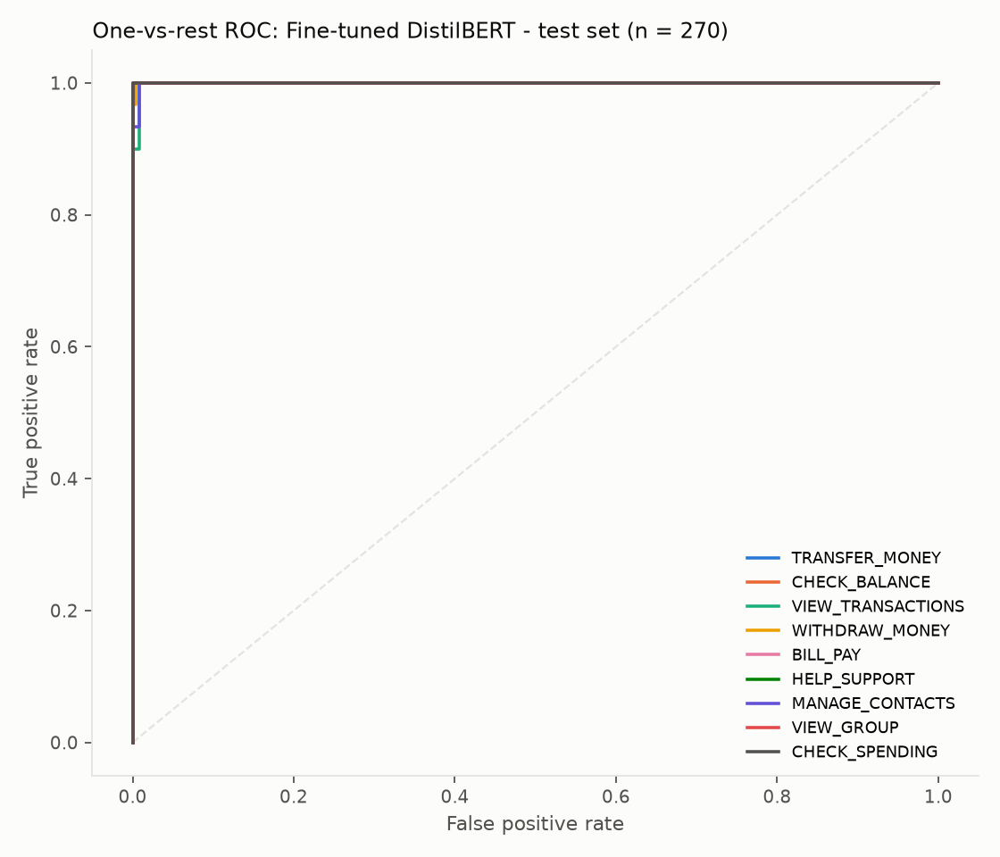
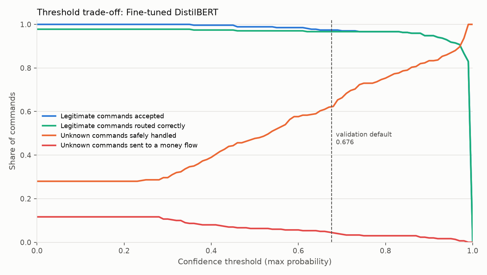

# Fine-tuned DistilBERT - evaluation report

_Generated 2026-11-16T18:08:28+00:00 from the model's actual predictions. Dataset `v5_deduplicated` (SHA-256 `8dc9c89cbb8af41f...`). Original implementation: Ricardo (ricardomanjarresr)._

## Headline (raw classifier, no confidence threshold)

| Metric | Value |
|---|---|
| Raw test accuracy | **97.8%** (264 / 270) |
| Test macro precision / recall / F1 | 0.979 / 0.978 / **0.978** |
| Test weighted F1 | 0.978 |
| Test macro ROC-AUC (one-vs-rest) | 1.000 |
| Train / validation accuracy | 100.0% / 92.2% |
| Parameters | 66,960,393 |
| Serialized model size | 134.65 MB |
| Training time (final fit / incl. search) | 19.0 s / 280.9 s |
| Latency P50 / P95 (single command, cuda) | 6.85 / 9.72 ms |

Raw accuracy counts every one of the legitimate test commands, before any confidence threshold.

## Selected configuration (chosen on validation only)

- Hyperparameters: `{'strategy': 'top_2_blocks', 'unfrozen_blocks': 2, 'learning_rate': 0.0001, 'epochs': 2, 'schedule_epochs': 6}`
- Rule: highest validation accuracy; ties -> lowest validation log loss; best epoch kept
- Configurations searched: 9

## Per-intent results (test)

| Intent | Precision | Recall | F1 | Support |
|---|---|---|---|---|
| TRANSFER_MONEY | 1.000 | 1.000 | 1.000 | 30 |
| CHECK_BALANCE | 0.968 | 1.000 | 0.984 | 30 |
| VIEW_TRANSACTIONS | 0.935 | 0.967 | 0.951 | 30 |
| WITHDRAW_MONEY | 1.000 | 0.900 | 0.947 | 30 |
| BILL_PAY | 1.000 | 1.000 | 1.000 | 30 |
| HELP_SUPPORT | 0.909 | 1.000 | 0.952 | 30 |
| MANAGE_CONTACTS | 1.000 | 0.933 | 0.966 | 30 |
| VIEW_GROUP | 1.000 | 1.000 | 1.000 | 30 |
| CHECK_SPENDING | 1.000 | 1.000 | 1.000 | 30 |

## Confidence threshold

Default threshold **0.6760**, calibrated on validation only: largest observed validation max-probability with coverage >= target (sole_intent.rejection.threshold_for_coverage); target coverage 95%, actual validation coverage 95.2%. No test or unknown-evaluation labels were used.

| Threshold | Coverage | Accepted | Correct accepted | Accuracy among accepted | Overall correct routing | Rejected | Unknown rejected | Unknown -> HELP_SUPPORT | Unknown safe fallback | Unknown -> money flow |
|---|---|---|---|---|---|---|---|---|---|---|
| none | 100.0% | 270 | 264 | 97.8% | 97.8% | 0 | 0.0% | 84 | 28.0% | 35 |
| default (0.676) | 97.4% | 263 | 261 | 99.2% | 96.7% | 7 | 45.0% | 51 | 62.0% | 14 |
| 0.25 | 100.0% | 270 | 264 | 97.8% | 97.8% | 0 | 1.0% | 83 | 28.7% | 35 |
| 0.30 | 100.0% | 270 | 264 | 97.8% | 97.8% | 0 | 2.7% | 81 | 29.7% | 32 |
| 0.35 | 100.0% | 270 | 264 | 97.8% | 97.8% | 0 | 9.7% | 75 | 34.7% | 26 |
| 0.40 | 99.6% | 269 | 263 | 97.8% | 97.4% | 1 | 15.3% | 71 | 39.0% | 24 |
| 0.50 | 98.9% | 267 | 262 | 98.1% | 97.0% | 3 | 27.7% | 60 | 47.7% | 19 |
| 0.60 | 98.5% | 266 | 262 | 98.5% | 97.0% | 4 | 39.0% | 56 | 57.7% | 17 |

*Accuracy among accepted* uses only the accepted commands as denominator; *overall correct routing* uses all legitimate test commands and counts rejections as failures. UNKNOWN_INTENT (rejected) and HELP_SUPPORT are counted separately; both are safe fallbacks.

## Secondary analyses (not part of the primary comparison)

- Typo robustness: accuracy with one keyboard slip per command 85.6% (clean 97.8%), macro F1 0.854.
- Temperature scaling (fit on validation): T = 1.060; test ECE 0.023 -> 0.026, test log loss 0.066 -> 0.068.
- Three-tier routing (open >= 0.676, menu >= 0.477): 96.7% of legitimate commands open the right workflow, 1.1% get a top-3 menu containing the right intent, 0.7% open a wrong workflow; 55.0% of unknown commands open a workflow (4.7% a money flow).

## Figures

## Provenance

- Training command: `python train.py --model distilbert`; evaluation command: `python evaluate.py --model all`
- Trained on: train; selected on: validation
- Artifact: `artifacts/distilbert` (7 files, hashes in `experiment_metadata.json`)
- Git commit at evaluation: `1cd668e6e692a9b99e4b4bd20a3bff4c7a08faf0`
