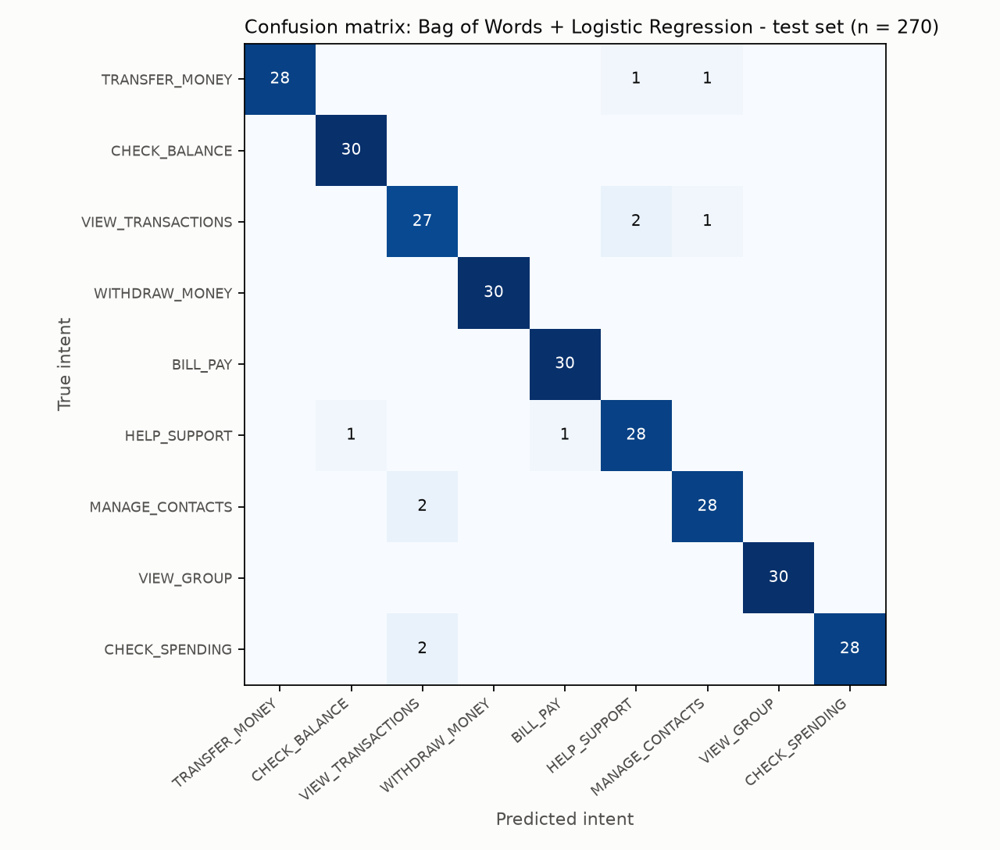
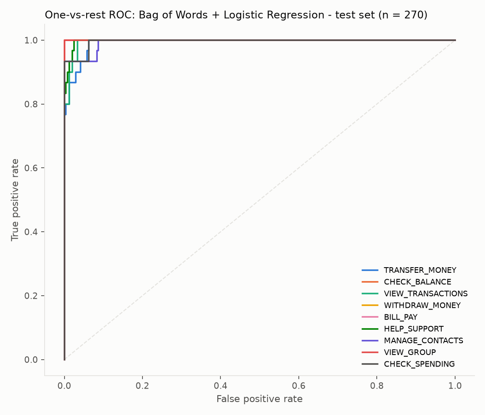
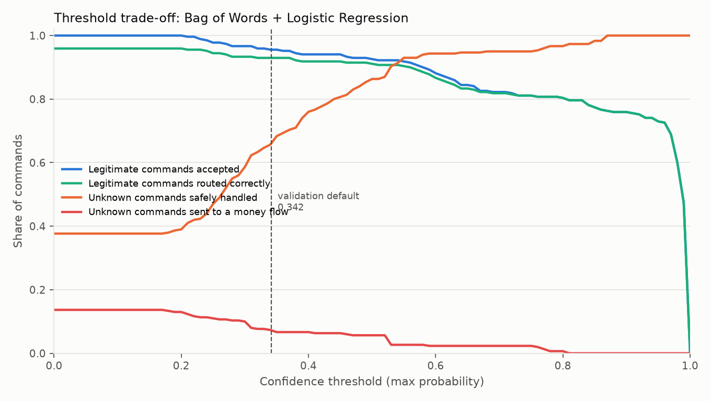

# Bag of Words + Logistic Regression - evaluation report

> **SECONDARY EXPERIMENT (trainval_refit)** - trained on train, validation; not part of the primary four-model comparison.

_Generated 2026-11-16T17:25:42+00:00 from the model's actual predictions. Dataset `v5_deduplicated` (SHA-256 `8dc9c89cbb8af41f...`). Original implementation: penin._

## Headline (raw classifier, no confidence threshold)

| Metric | Value |
|---|---|
| Raw test accuracy | **95.9%** (259 / 270) |
| Test macro precision / recall / F1 | 0.960 / 0.959 / **0.959** |
| Test weighted F1 | 0.959 |
| Test macro ROC-AUC (one-vs-rest) | 0.997 |
| Train / validation accuracy | 100.0% / 100.0% |
| Parameters | 24,858 |
| Serialized model size | 0.24 MB |
| Training time (final fit / incl. search) | 0.2 s / 2.1 s |
| Latency P50 / P95 (single command, cpu) | 0.23 / 0.26 ms |

Raw accuracy counts every one of the legitimate test commands, before any confidence threshold.

## Selected configuration (chosen on validation only)

- Hyperparameters: `{'ngram_range': [1, 2], 'C': 10.0, 'binary': True}`
- Rule: highest validation macro F1; ties -> lowest validation log loss
- Configurations searched: 12

## Per-intent results (test)

| Intent | Precision | Recall | F1 | Support |
|---|---|---|---|---|
| TRANSFER_MONEY | 1.000 | 0.933 | 0.966 | 30 |
| CHECK_BALANCE | 0.968 | 1.000 | 0.984 | 30 |
| VIEW_TRANSACTIONS | 0.871 | 0.900 | 0.885 | 30 |
| WITHDRAW_MONEY | 1.000 | 1.000 | 1.000 | 30 |
| BILL_PAY | 0.968 | 1.000 | 0.984 | 30 |
| HELP_SUPPORT | 0.903 | 0.933 | 0.918 | 30 |
| MANAGE_CONTACTS | 0.933 | 0.933 | 0.933 | 30 |
| VIEW_GROUP | 1.000 | 1.000 | 1.000 | 30 |
| CHECK_SPENDING | 1.000 | 0.933 | 0.966 | 30 |

## Confidence threshold

Default threshold **0.3415**, calibrated on validation only: largest observed validation max-probability with coverage >= target (sole_intent.rejection.threshold_for_coverage); target coverage 95%, actual validation coverage 95.2%. No test or unknown-evaluation labels were used.

| Threshold | Coverage | Accepted | Correct accepted | Accuracy among accepted | Overall correct routing | Rejected | Unknown rejected | Unknown -> HELP_SUPPORT | Unknown safe fallback | Unknown -> money flow |
|---|---|---|---|---|---|---|---|---|---|---|
| none | 100.0% | 270 | 259 | 95.9% | 95.9% | 0 | 0.0% | 113 | 37.7% | 41 |
| default (0.342) | 95.6% | 258 | 251 | 97.3% | 93.0% | 12 | 33.7% | 97 | 66.0% | 22 |
| 0.25 | 97.8% | 264 | 255 | 96.6% | 94.4% | 6 | 10.7% | 109 | 47.0% | 33 |
| 0.30 | 96.7% | 261 | 252 | 96.6% | 93.3% | 9 | 25.0% | 101 | 58.7% | 30 |
| 0.35 | 95.6% | 258 | 251 | 97.3% | 93.0% | 12 | 37.0% | 94 | 68.3% | 20 |
| 0.40 | 94.1% | 254 | 248 | 97.6% | 91.9% | 16 | 47.3% | 86 | 76.0% | 20 |
| 0.50 | 92.6% | 250 | 246 | 98.4% | 91.1% | 20 | 70.7% | 47 | 86.3% | 17 |
| 0.60 | 88.1% | 238 | 234 | 98.3% | 86.7% | 32 | 86.7% | 23 | 94.3% | 7 |

*Accuracy among accepted* uses only the accepted commands as denominator; *overall correct routing* uses all legitimate test commands and counts rejections as failures. UNKNOWN_INTENT (rejected) and HELP_SUPPORT are counted separately; both are safe fallbacks.

## Secondary analyses (not part of the primary comparison)

- Typo robustness: accuracy with one keyboard slip per command 82.2% (clean 95.9%), macro F1 0.824.
- Temperature scaling (fit on validation): T = 0.059; test ECE 0.071 -> 0.041, test log loss 0.212 -> 0.512.
- Three-tier routing (open >= 0.342, menu >= 0.342): 93.0% of legitimate commands open the right workflow, 0.0% get a top-3 menu containing the right intent, 2.6% open a wrong workflow; 66.3% of unknown commands open a workflow (7.3% a money flow).

## Figures

## Provenance

- Training command: `python train.py --model bow --protocol trainval_refit`; evaluation command: `python evaluate.py --model bow --label trainval_refit`
- Trained on: train, validation; selected on: validation
- Artifact: `artifacts/secondary/bow_trainval_refit` (2 files, hashes in `experiment_metadata.json`)
- Git commit at evaluation: `1cd668e6e692a9b99e4b4bd20a3bff4c7a08faf0`
