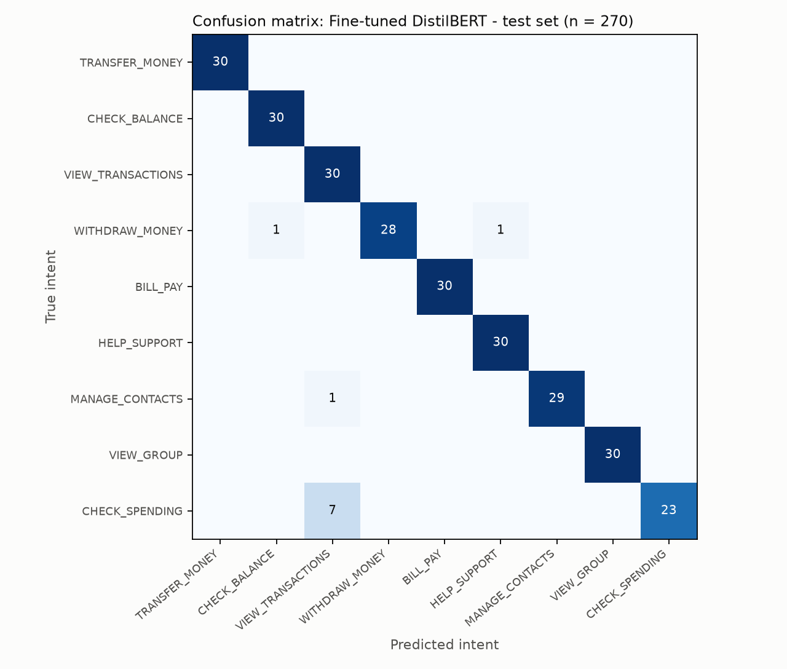
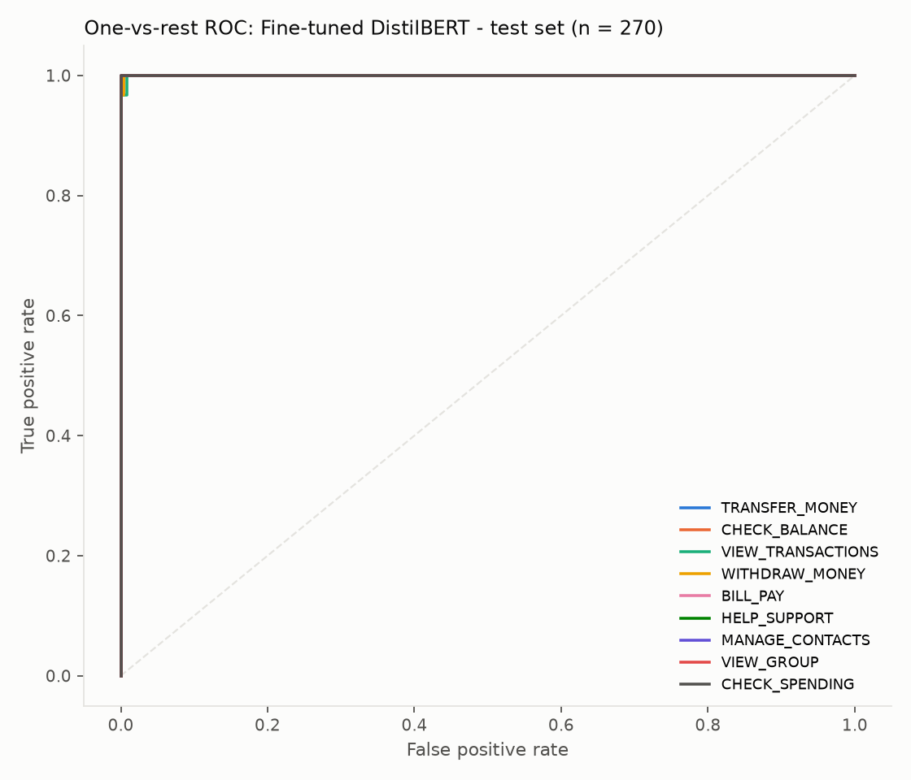
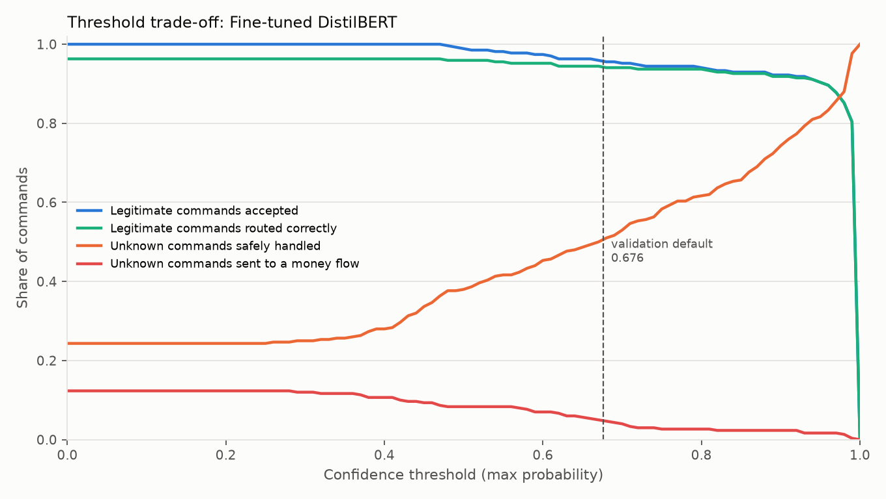

# Fine-tuned DistilBERT - evaluation report

> **SECONDARY EXPERIMENT (trainval_refit)** - trained on train, validation; not part of the primary four-model comparison.

_Generated 2026-11-16T18:04:25+00:00 from the model's actual predictions. Dataset `v5_deduplicated` (SHA-256 `8dc9c89cbb8af41f...`). Original implementation: Ricardo (ricardomanjarresr)._

## Headline (raw classifier, no confidence threshold)

| Metric | Value |
|---|---|
| Raw test accuracy | **96.3%** (260 / 270) |
| Test macro precision / recall / F1 | 0.969 / 0.963 / **0.963** |
| Test weighted F1 | 0.963 |
| Test macro ROC-AUC (one-vs-rest) | 1.000 |
| Train / validation accuracy | 100.0% / 99.6% |
| Parameters | 66,960,393 |
| Serialized model size | 134.65 MB |
| Training time (final fit / incl. search) | 8.7 s / 298.9 s |
| Latency P50 / P95 (single command, cuda) | 7.05 / 8.90 ms |

Raw accuracy counts every one of the legitimate test commands, before any confidence threshold.

## Selected configuration (chosen on validation only)

- Hyperparameters: `{'strategy': 'top_2_blocks', 'unfrozen_blocks': 2, 'learning_rate': 0.0001, 'epochs': 2, 'schedule_epochs': 6}`
- Rule: highest validation accuracy; ties -> lowest validation log loss; best epoch kept
- Configurations searched: 9

## Per-intent results (test)

| Intent | Precision | Recall | F1 | Support |
|---|---|---|---|---|
| TRANSFER_MONEY | 1.000 | 1.000 | 1.000 | 30 |
| CHECK_BALANCE | 0.968 | 1.000 | 0.984 | 30 |
| VIEW_TRANSACTIONS | 0.789 | 1.000 | 0.882 | 30 |
| WITHDRAW_MONEY | 1.000 | 0.933 | 0.966 | 30 |
| BILL_PAY | 1.000 | 1.000 | 1.000 | 30 |
| HELP_SUPPORT | 0.968 | 1.000 | 0.984 | 30 |
| MANAGE_CONTACTS | 1.000 | 0.967 | 0.983 | 30 |
| VIEW_GROUP | 1.000 | 1.000 | 1.000 | 30 |
| CHECK_SPENDING | 1.000 | 0.767 | 0.868 | 30 |

## Confidence threshold

Default threshold **0.6760**, calibrated on validation only: largest observed validation max-probability with coverage >= target (sole_intent.rejection.threshold_for_coverage); target coverage 95%, actual validation coverage 95.2%. No test or unknown-evaluation labels were used.

| Threshold | Coverage | Accepted | Correct accepted | Accuracy among accepted | Overall correct routing | Rejected | Unknown rejected | Unknown -> HELP_SUPPORT | Unknown safe fallback | Unknown -> money flow |
|---|---|---|---|---|---|---|---|---|---|---|
| none | 100.0% | 270 | 260 | 96.3% | 96.3% | 0 | 0.0% | 73 | 24.3% | 37 |
| default (0.676) | 95.9% | 259 | 255 | 98.5% | 94.4% | 11 | 37.3% | 41 | 51.0% | 14 |
| 0.25 | 100.0% | 270 | 260 | 96.3% | 96.3% | 0 | 0.0% | 73 | 24.3% | 37 |
| 0.30 | 100.0% | 270 | 260 | 96.3% | 96.3% | 0 | 1.0% | 72 | 25.0% | 36 |
| 0.35 | 100.0% | 270 | 260 | 96.3% | 96.3% | 0 | 2.0% | 71 | 25.7% | 35 |
| 0.40 | 100.0% | 270 | 260 | 96.3% | 96.3% | 0 | 5.7% | 67 | 28.0% | 32 |
| 0.50 | 98.9% | 267 | 259 | 97.0% | 95.9% | 3 | 18.3% | 59 | 38.0% | 25 |
| 0.60 | 97.4% | 263 | 257 | 97.7% | 95.2% | 7 | 30.0% | 46 | 45.3% | 21 |

*Accuracy among accepted* uses only the accepted commands as denominator; *overall correct routing* uses all legitimate test commands and counts rejections as failures. UNKNOWN_INTENT (rejected) and HELP_SUPPORT are counted separately; both are safe fallbacks.

## Secondary analyses (not part of the primary comparison)

- Typo robustness: accuracy with one keyboard slip per command 80.7% (clean 96.3%), macro F1 0.804.
- Temperature scaling (fit on validation): T = 0.683; test ECE 0.016 -> 0.017, test log loss 0.074 -> 0.075.
- Three-tier routing (open >= 0.676, menu >= 0.676): 94.4% of legitimate commands open the right workflow, 0.0% get a top-3 menu containing the right intent, 1.5% open a wrong workflow; 62.7% of unknown commands open a workflow (4.7% a money flow).

## Figures

## Provenance

- Training command: `python train.py --model distilbert --protocol trainval_refit`; evaluation command: `python evaluate.py --model distilbert --label trainval_refit`
- Trained on: train, validation; selected on: validation
- Artifact: `artifacts/secondary/distilbert_trainval_refit` (7 files, hashes in `experiment_metadata.json`)
- Git commit at evaluation: `1cd668e6e692a9b99e4b4bd20a3bff4c7a08faf0`
