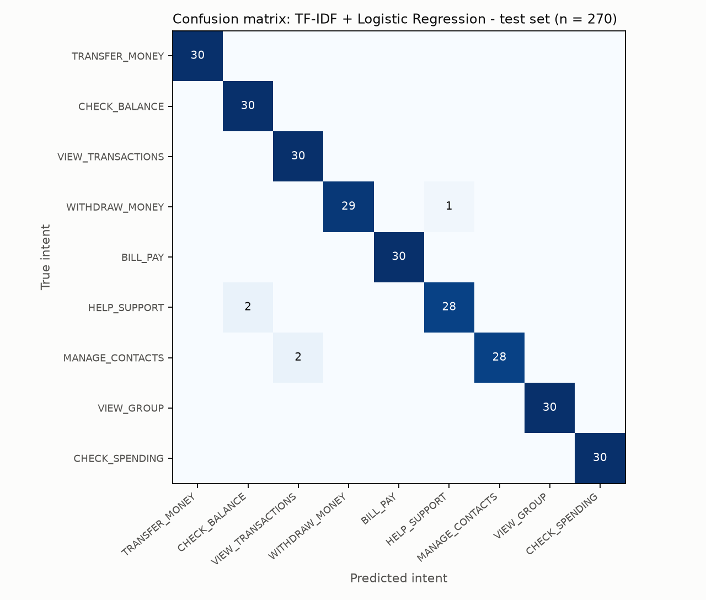
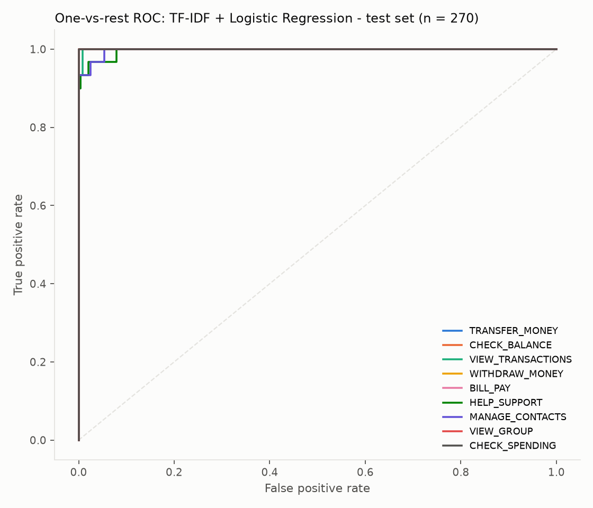
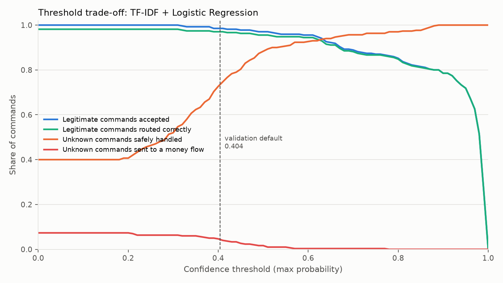

# TF-IDF + Logistic Regression - evaluation report

> **SECONDARY EXPERIMENT (trainval_refit)** - trained on train, validation; not part of the primary four-model comparison.

_Generated 2026-11-16T17:25:50+00:00 from the model's actual predictions. Dataset `v5_deduplicated` (SHA-256 `8dc9c89cbb8af41f...`). Original implementation: Chelsea Cheng._

## Headline (raw classifier, no confidence threshold)

| Metric | Value |
|---|---|
| Raw test accuracy | **98.1%** (265 / 270) |
| Test macro precision / recall / F1 | 0.982 / 0.981 / **0.981** |
| Test weighted F1 | 0.981 |
| Test macro ROC-AUC (one-vs-rest) | 0.999 |
| Train / validation accuracy | 100.0% / 100.0% |
| Parameters | 64,359 |
| Serialized model size | 0.66 MB |
| Training time (final fit / incl. search) | 0.6 s / 19.0 s |
| Latency P50 / P95 (single command, cpu) | 1.01 / 1.12 ms |

Raw accuracy counts every one of the legitimate test commands, before any confidence threshold.

## Selected configuration (chosen on validation only)

- Hyperparameters: `{'word_ngram': [1, 2], 'char': [2, 5], 'C': 10}`
- Rule: highest validation macro F1 across both representations; ties -> first in grid order (simpler model, smaller C), as in the original script
- Configurations searched: 35

## Per-intent results (test)

| Intent | Precision | Recall | F1 | Support |
|---|---|---|---|---|
| TRANSFER_MONEY | 1.000 | 1.000 | 1.000 | 30 |
| CHECK_BALANCE | 0.938 | 1.000 | 0.968 | 30 |
| VIEW_TRANSACTIONS | 0.938 | 1.000 | 0.968 | 30 |
| WITHDRAW_MONEY | 1.000 | 0.967 | 0.983 | 30 |
| BILL_PAY | 1.000 | 1.000 | 1.000 | 30 |
| HELP_SUPPORT | 0.966 | 0.933 | 0.949 | 30 |
| MANAGE_CONTACTS | 1.000 | 0.933 | 0.966 | 30 |
| VIEW_GROUP | 1.000 | 1.000 | 1.000 | 30 |
| CHECK_SPENDING | 1.000 | 1.000 | 1.000 | 30 |

## Confidence threshold

Default threshold **0.4042**, calibrated on validation only: largest observed validation max-probability with coverage >= target (sole_intent.rejection.threshold_for_coverage); target coverage 95%, actual validation coverage 95.2%. No test or unknown-evaluation labels were used.

| Threshold | Coverage | Accepted | Correct accepted | Accuracy among accepted | Overall correct routing | Rejected | Unknown rejected | Unknown -> HELP_SUPPORT | Unknown safe fallback | Unknown -> money flow |
|---|---|---|---|---|---|---|---|---|---|---|
| none | 100.0% | 270 | 265 | 98.1% | 98.1% | 0 | 0.0% | 120 | 40.0% | 22 |
| default (0.404) | 98.5% | 266 | 262 | 98.5% | 97.0% | 4 | 50.7% | 67 | 73.0% | 14 |
| 0.25 | 100.0% | 270 | 265 | 98.1% | 98.1% | 0 | 10.7% | 107 | 46.3% | 19 |
| 0.30 | 100.0% | 270 | 265 | 98.1% | 98.1% | 0 | 18.7% | 100 | 52.0% | 19 |
| 0.35 | 99.3% | 268 | 263 | 98.1% | 97.4% | 2 | 34.7% | 83 | 62.3% | 18 |
| 0.40 | 98.5% | 266 | 262 | 98.5% | 97.0% | 4 | 49.7% | 69 | 72.7% | 14 |
| 0.50 | 97.0% | 262 | 258 | 98.5% | 95.6% | 8 | 71.7% | 50 | 88.3% | 5 |
| 0.60 | 95.6% | 258 | 255 | 98.8% | 94.4% | 12 | 82.0% | 32 | 92.7% | 1 |

*Accuracy among accepted* uses only the accepted commands as denominator; *overall correct routing* uses all legitimate test commands and counts rejections as failures. UNKNOWN_INTENT (rejected) and HELP_SUPPORT are counted separately; both are safe fallbacks.

## Secondary analyses (not part of the primary comparison)

- Typo robustness: accuracy with one keyboard slip per command 96.3% (clean 98.1%), macro F1 0.963.
- Temperature scaling (fit on validation): T = 0.058; test ECE 0.065 -> 0.020, test log loss 0.135 -> 0.258.
- Three-tier routing (open >= 0.404, menu >= 0.404): 97.0% of legitimate commands open the right workflow, 0.0% get a top-3 menu containing the right intent, 1.5% open a wrong workflow; 49.3% of unknown commands open a workflow (4.7% a money flow).

## Figures

## Provenance

- Training command: `python train.py --model tfidf --protocol trainval_refit`; evaluation command: `python evaluate.py --model tfidf --label trainval_refit`
- Trained on: train, validation; selected on: validation
- Artifact: `artifacts/secondary/tfidf_trainval_refit` (2 files, hashes in `experiment_metadata.json`)
- Git commit at evaluation: `1cd668e6e692a9b99e4b4bd20a3bff4c7a08faf0`
