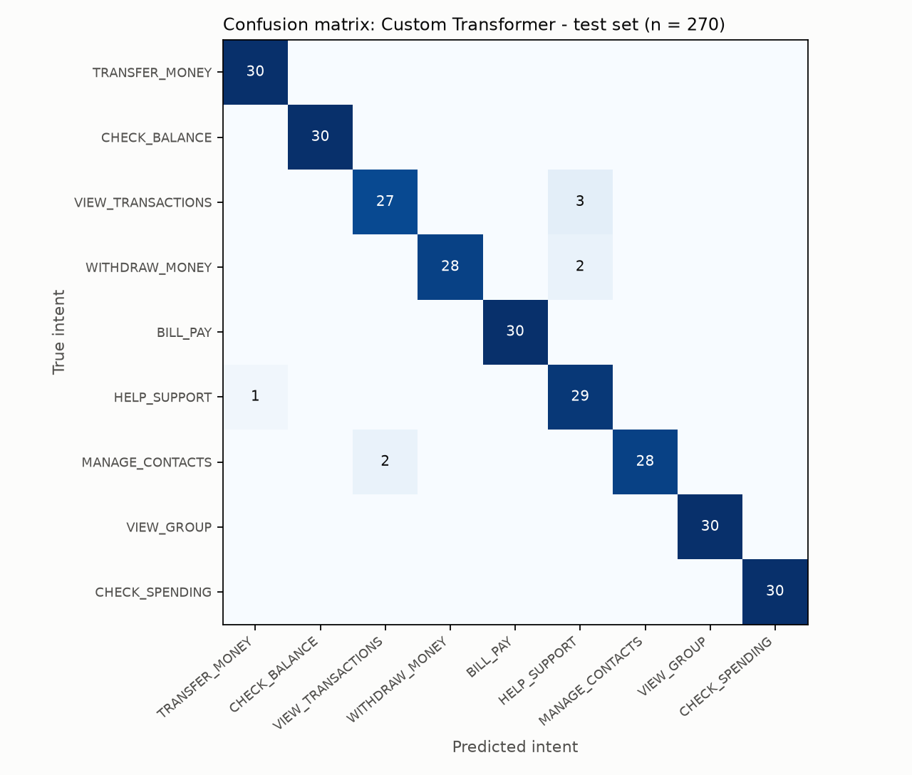
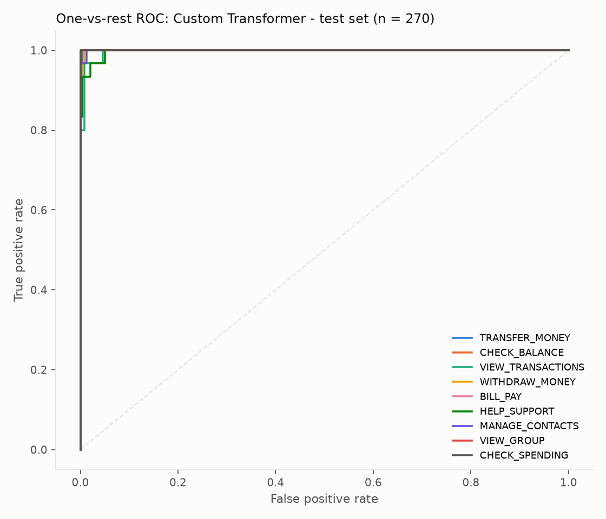
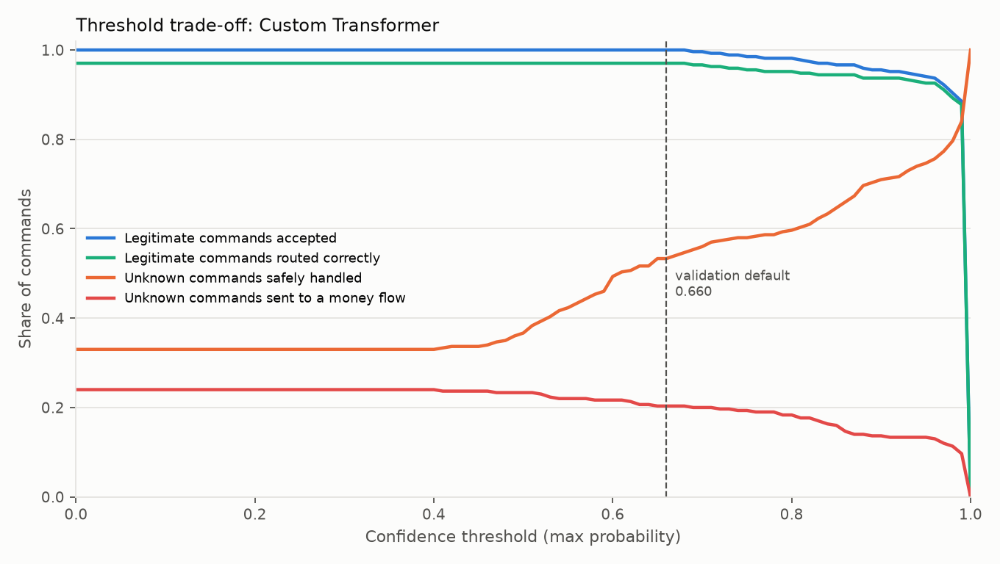

# Custom Transformer - evaluation report

> **SECONDARY EXPERIMENT (trainval_refit)** - trained on train, validation; not part of the primary four-model comparison.

_Generated 2026-11-16T17:58:53+00:00 from the model's actual predictions. Dataset `v5_deduplicated` (SHA-256 `8dc9c89cbb8af41f...`). Original implementation: Felipe (friosf)._

## Headline (raw classifier, no confidence threshold)

| Metric | Value |
|---|---|
| Raw test accuracy | **97.0%** (262 / 270) |
| Test macro precision / recall / F1 | 0.972 / 0.970 / **0.971** |
| Test weighted F1 | 0.971 |
| Test macro ROC-AUC (one-vs-rest) | 0.999 |
| Train / validation accuracy | 99.9% / 98.9% |
| Parameters | 233,361 |
| Serialized model size | 2.94 MB |
| Training time (final fit / incl. search) | 14.8 s / 1742.3 s |
| Latency P50 / P95 (single command, cuda) | 12.84 / 19.15 ms |

Raw accuracy counts every one of the legitimate test commands, before any confidence threshold.

## Selected configuration (chosen on validation only)

- Hyperparameters: `{'num_heads': 4, 'num_blocks': 2, 'dropout': 0.2, 'learning_rate': 0.001, 'epochs': 5}`
- Rule: highest validation accuracy; ties -> lowest validation log loss; best epoch kept (patience 10)
- Configurations searched: 36

## Per-intent results (test)

| Intent | Precision | Recall | F1 | Support |
|---|---|---|---|---|
| TRANSFER_MONEY | 0.968 | 1.000 | 0.984 | 30 |
| CHECK_BALANCE | 1.000 | 1.000 | 1.000 | 30 |
| VIEW_TRANSACTIONS | 0.931 | 0.900 | 0.915 | 30 |
| WITHDRAW_MONEY | 1.000 | 0.933 | 0.966 | 30 |
| BILL_PAY | 1.000 | 1.000 | 1.000 | 30 |
| HELP_SUPPORT | 0.853 | 0.967 | 0.906 | 30 |
| MANAGE_CONTACTS | 1.000 | 0.933 | 0.966 | 30 |
| VIEW_GROUP | 1.000 | 1.000 | 1.000 | 30 |
| CHECK_SPENDING | 1.000 | 1.000 | 1.000 | 30 |

## Confidence threshold

Default threshold **0.6597**, calibrated on validation only: largest observed validation max-probability with coverage >= target (sole_intent.rejection.threshold_for_coverage); target coverage 95%, actual validation coverage 95.2%. No test or unknown-evaluation labels were used.

| Threshold | Coverage | Accepted | Correct accepted | Accuracy among accepted | Overall correct routing | Rejected | Unknown rejected | Unknown -> HELP_SUPPORT | Unknown safe fallback | Unknown -> money flow |
|---|---|---|---|---|---|---|---|---|---|---|
| none | 100.0% | 270 | 262 | 97.0% | 97.0% | 0 | 0.0% | 99 | 33.0% | 72 |
| default (0.660) | 100.0% | 270 | 262 | 97.0% | 97.0% | 0 | 22.3% | 93 | 53.3% | 61 |
| 0.25 | 100.0% | 270 | 262 | 97.0% | 97.0% | 0 | 0.0% | 99 | 33.0% | 72 |
| 0.30 | 100.0% | 270 | 262 | 97.0% | 97.0% | 0 | 0.0% | 99 | 33.0% | 72 |
| 0.35 | 100.0% | 270 | 262 | 97.0% | 97.0% | 0 | 0.0% | 99 | 33.0% | 72 |
| 0.40 | 100.0% | 270 | 262 | 97.0% | 97.0% | 0 | 0.0% | 99 | 33.0% | 72 |
| 0.50 | 100.0% | 270 | 262 | 97.0% | 97.0% | 0 | 4.7% | 96 | 36.7% | 70 |
| 0.60 | 100.0% | 270 | 262 | 97.0% | 97.0% | 0 | 17.7% | 95 | 49.3% | 65 |

*Accuracy among accepted* uses only the accepted commands as denominator; *overall correct routing* uses all legitimate test commands and counts rejections as failures. UNKNOWN_INTENT (rejected) and HELP_SUPPORT are counted separately; both are safe fallbacks.

## Secondary analyses (not part of the primary comparison)

- Typo robustness: accuracy with one keyboard slip per command 76.7% (clean 97.0%), macro F1 0.777.
- Temperature scaling (fit on validation): T = 1.125; test ECE 0.028 -> 0.023, test log loss 0.108 -> 0.101.
- Three-tier routing (open >= 0.660, menu >= 0.660): 97.0% of legitimate commands open the right workflow, 0.0% get a top-3 menu containing the right intent, 3.0% open a wrong workflow; 77.7% of unknown commands open a workflow (20.3% a money flow).

## Figures

## Provenance

- Training command: `python train.py --model transformer --protocol trainval_refit`; evaluation command: `python evaluate.py --model transformer --label trainval_refit`
- Trained on: train, validation; selected on: validation
- Artifact: `artifacts/secondary/transformer_trainval_refit` (5 files, hashes in `experiment_metadata.json`)
- Git commit at evaluation: `1cd668e6e692a9b99e4b4bd20a3bff4c7a08faf0`
