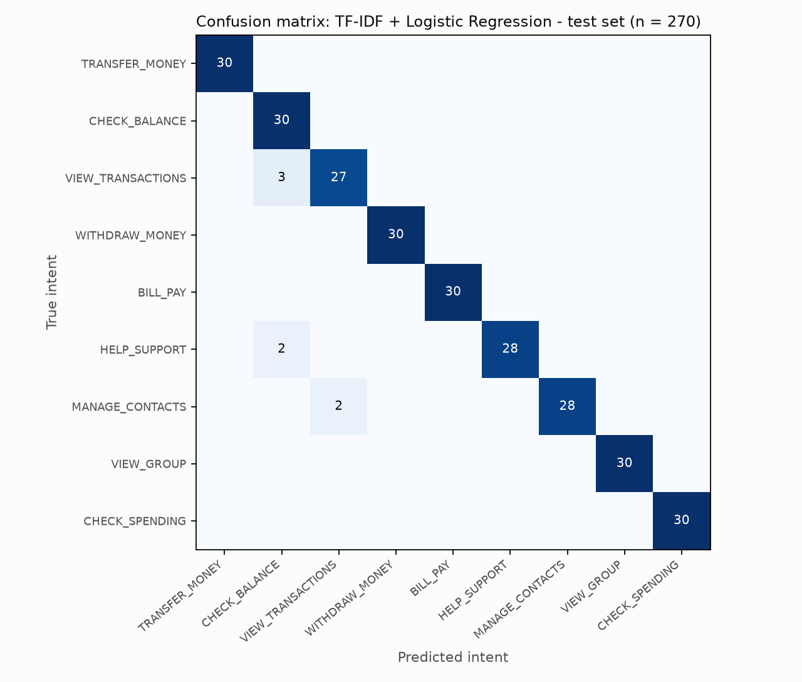
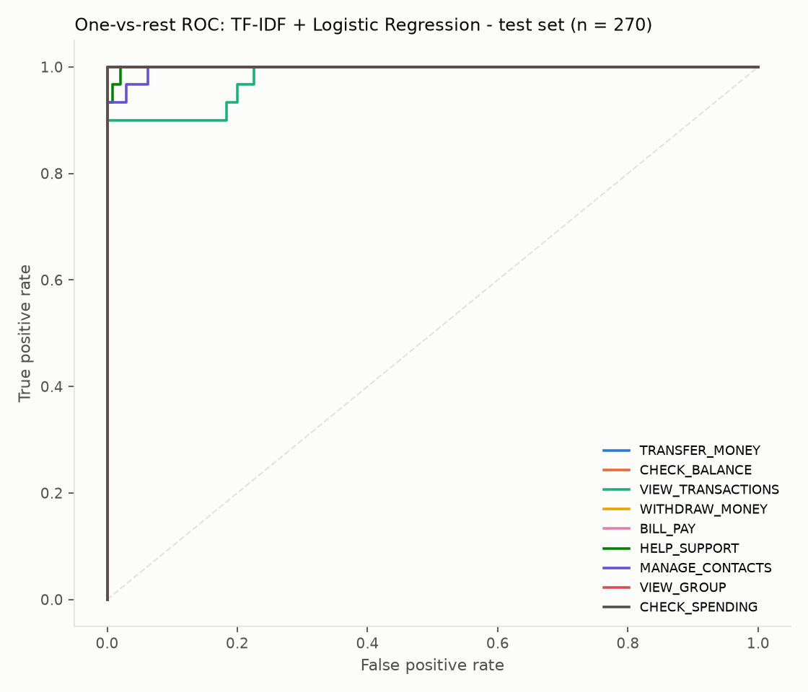
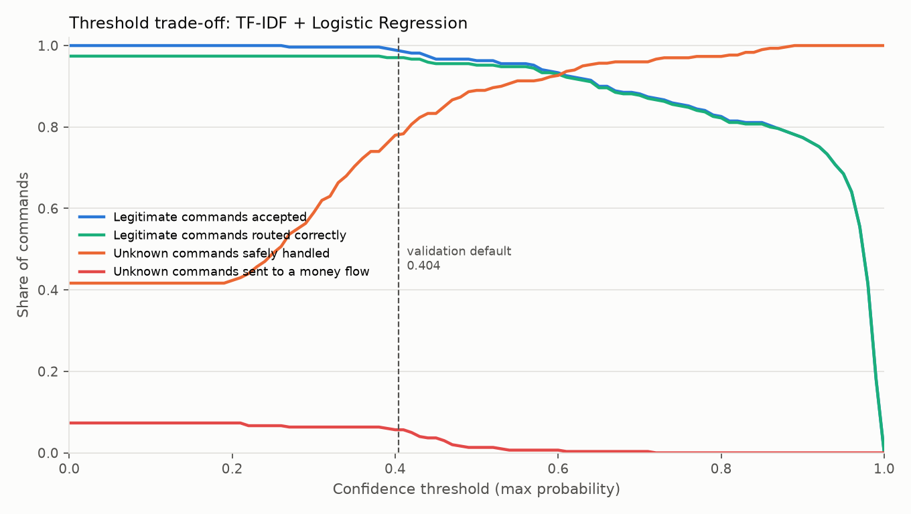

# TF-IDF + Logistic Regression - evaluation report

_Generated 2026-11-16T18:08:01+00:00 from the model's actual predictions. Dataset `v5_deduplicated` (SHA-256 `8dc9c89cbb8af41f...`). Original implementation: Chelsea Cheng._

## Headline (raw classifier, no confidence threshold)

| Metric | Value |
|---|---|
| Raw test accuracy | **97.4%** (263 / 270) |
| Test macro precision / recall / F1 | 0.976 / 0.974 / **0.974** |
| Test weighted F1 | 0.974 |
| Test macro ROC-AUC (one-vs-rest) | 0.997 |
| Train / validation accuracy | 100.0% / 94.1% |
| Parameters | 61,983 |
| Serialized model size | 0.64 MB |
| Training time (final fit / incl. search) | 0.4 s / 16.3 s |
| Latency P50 / P95 (single command, cpu) | 1.70 / 2.66 ms |

Raw accuracy counts every one of the legitimate test commands, before any confidence threshold.

## Selected configuration (chosen on validation only)

- Hyperparameters: `{'word_ngram': [1, 2], 'char': [2, 5], 'C': 10}`
- Rule: highest validation macro F1 across both representations; ties -> first in grid order (simpler model, smaller C), as in the original script
- Configurations searched: 35

## Per-intent results (test)

| Intent | Precision | Recall | F1 | Support |
|---|---|---|---|---|
| TRANSFER_MONEY | 1.000 | 1.000 | 1.000 | 30 |
| CHECK_BALANCE | 0.857 | 1.000 | 0.923 | 30 |
| VIEW_TRANSACTIONS | 0.931 | 0.900 | 0.915 | 30 |
| WITHDRAW_MONEY | 1.000 | 1.000 | 1.000 | 30 |
| BILL_PAY | 1.000 | 1.000 | 1.000 | 30 |
| HELP_SUPPORT | 1.000 | 0.933 | 0.966 | 30 |
| MANAGE_CONTACTS | 1.000 | 0.933 | 0.966 | 30 |
| VIEW_GROUP | 1.000 | 1.000 | 1.000 | 30 |
| CHECK_SPENDING | 1.000 | 1.000 | 1.000 | 30 |

## Confidence threshold

Default threshold **0.4042**, calibrated on validation only: largest observed validation max-probability with coverage >= target (sole_intent.rejection.threshold_for_coverage); target coverage 95%, actual validation coverage 95.2%. No test or unknown-evaluation labels were used.

| Threshold | Coverage | Accepted | Correct accepted | Accuracy among accepted | Overall correct routing | Rejected | Unknown rejected | Unknown -> HELP_SUPPORT | Unknown safe fallback | Unknown -> money flow |
|---|---|---|---|---|---|---|---|---|---|---|
| none | 100.0% | 270 | 263 | 97.4% | 97.4% | 0 | 0.0% | 125 | 41.7% | 22 |
| default (0.404) | 98.9% | 267 | 262 | 98.1% | 97.0% | 3 | 51.3% | 81 | 78.3% | 17 |
| 0.25 | 100.0% | 270 | 263 | 97.4% | 97.4% | 0 | 11.7% | 112 | 49.0% | 20 |
| 0.30 | 99.6% | 269 | 263 | 97.8% | 97.4% | 1 | 23.0% | 108 | 59.0% | 19 |
| 0.35 | 99.6% | 269 | 263 | 97.8% | 97.4% | 1 | 38.0% | 97 | 70.3% | 19 |
| 0.40 | 98.9% | 267 | 262 | 98.1% | 97.0% | 3 | 50.7% | 82 | 78.0% | 17 |
| 0.50 | 96.3% | 260 | 257 | 98.8% | 95.2% | 10 | 69.3% | 59 | 89.0% | 4 |
| 0.60 | 93.3% | 252 | 251 | 99.6% | 93.0% | 18 | 82.7% | 30 | 92.7% | 2 |

*Accuracy among accepted* uses only the accepted commands as denominator; *overall correct routing* uses all legitimate test commands and counts rejections as failures. UNKNOWN_INTENT (rejected) and HELP_SUPPORT are counted separately; both are safe fallbacks.

## Secondary analyses (not part of the primary comparison)

- Typo robustness: accuracy with one keyboard slip per command 95.9% (clean 97.4%), macro F1 0.960.
- Temperature scaling (fit on validation): T = 0.667; test ECE 0.069 -> 0.026, test log loss 0.169 -> 0.124.
- Three-tier routing (open >= 0.404, menu >= 0.265): 97.0% of legitimate commands open the right workflow, 1.1% get a top-3 menu containing the right intent, 1.9% open a wrong workflow; 48.7% of unknown commands open a workflow (5.7% a money flow).

## Figures

## Provenance

- Training command: `python -c`; evaluation command: `python evaluate.py --model all`
- Trained on: train; selected on: validation
- Artifact: `artifacts/tfidf` (2 files, hashes in `experiment_metadata.json`)
- Git commit at evaluation: `1cd668e6e692a9b99e4b4bd20a3bff4c7a08faf0`
